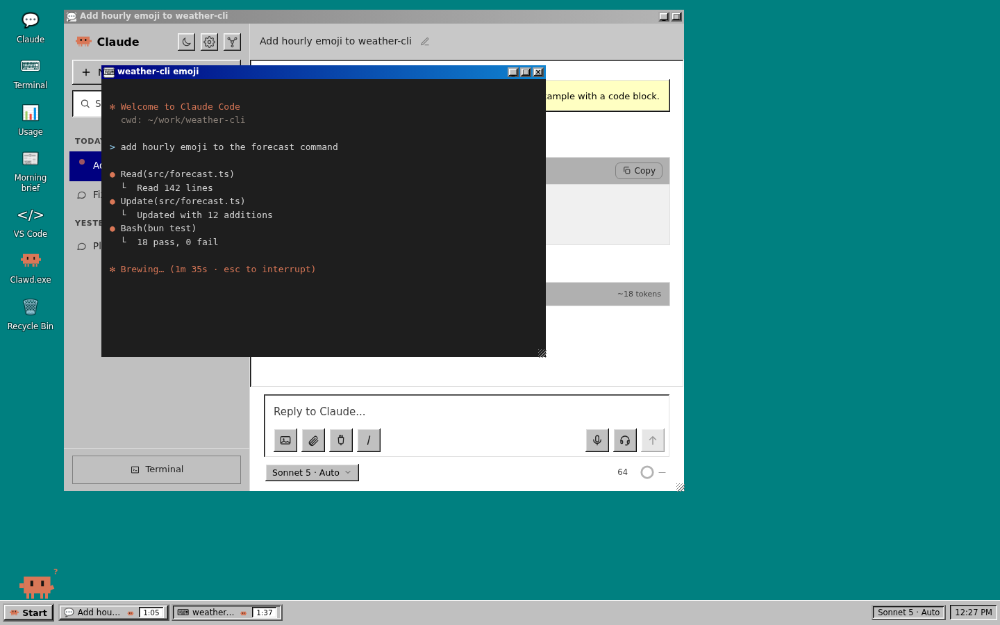
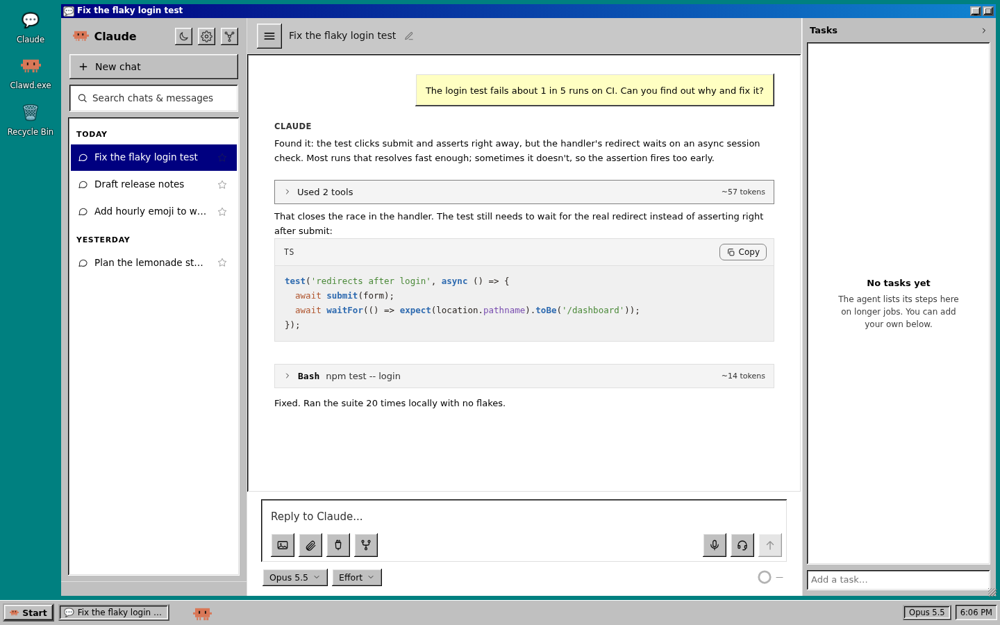
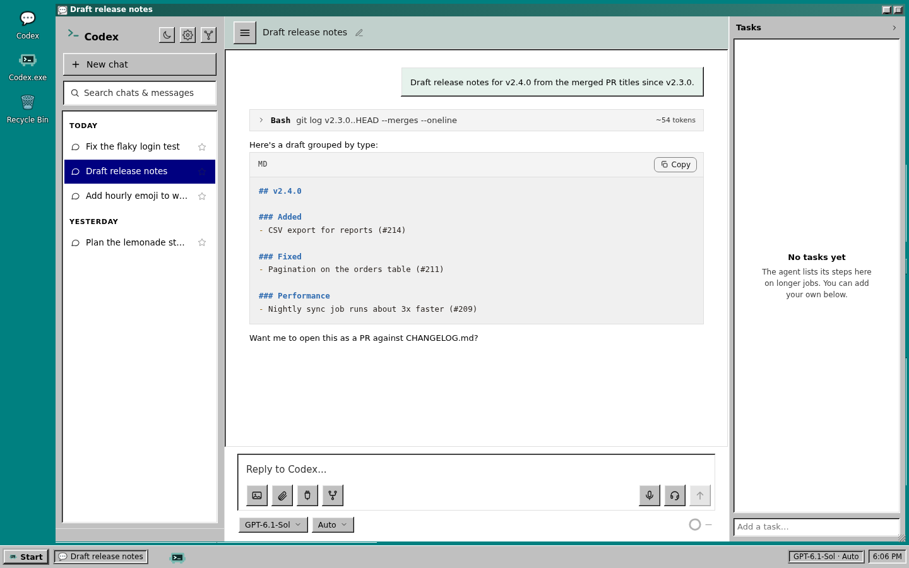
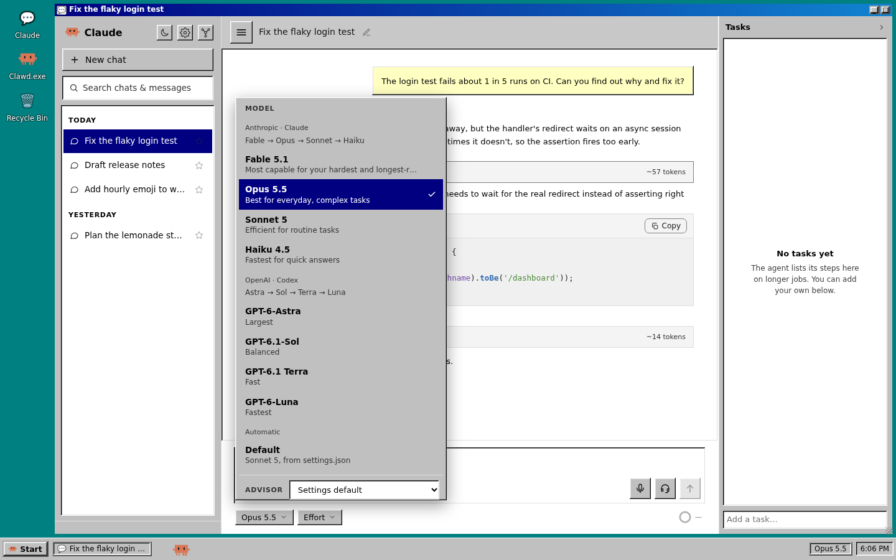
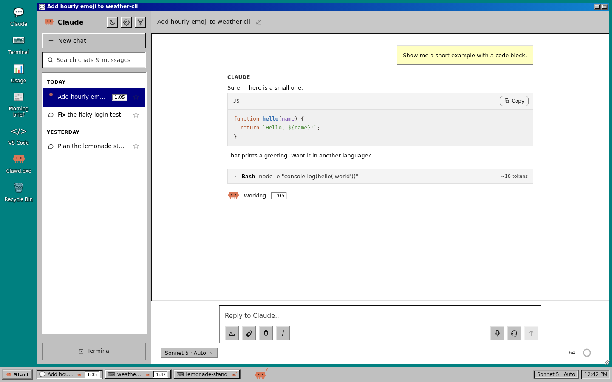
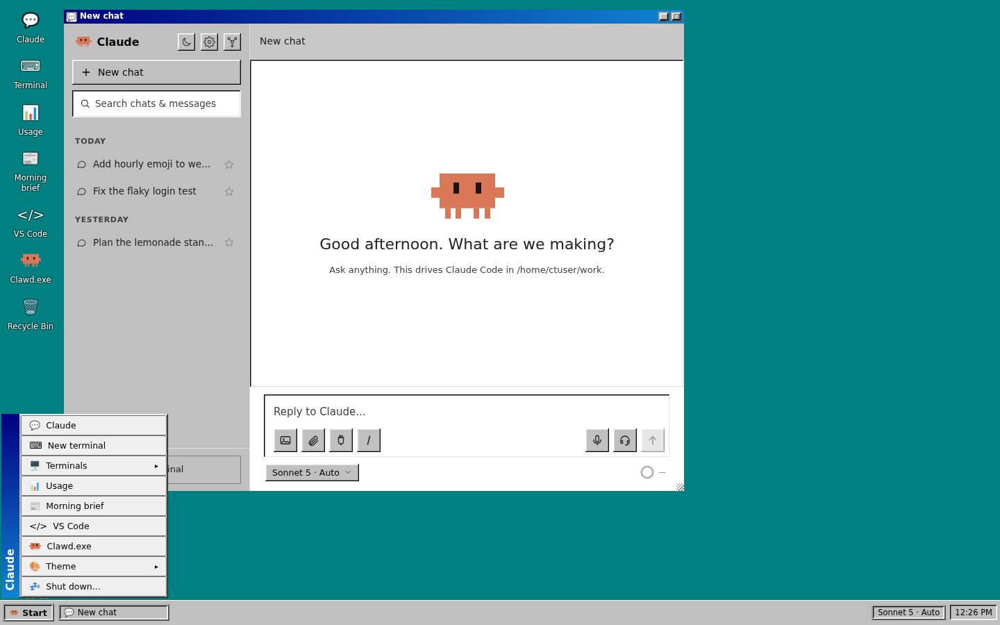
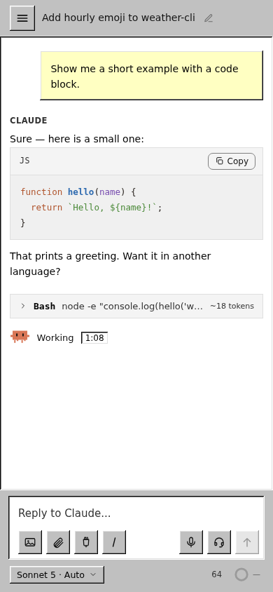

<h1 align="center">Claude Terminal</h1>

<p align="center">A self-hosted browser companion for Claude Code and OpenAI Codex.</p>

<p align="center">
  
  
  
  
  
</p>

<p align="center">A fork of <a href="https://github.com/Filip-Kin/claude-terminal">Filip-Kin/claude-terminal</a>.</p>

<p align="center">
  <a href="#what-you-get">What you get</a> ·
  <a href="#claude-and-codex">Claude and Codex</a> ·
  <a href="#quick-start">Quick start</a> ·
  <a href="#reference">Reference</a>
</p>

<p align="center"><a href="docs/screenshots/desktop.png"></a></p>

<p align="center">Chat, terminals and task timers in one desktop. Screenshots use invented demo data.</p>

## What you get

<table>
<tr>
<td width="50%" valign="top"><strong>Claude and Codex</strong><br>Chat at <code>/app</code>, switch providers with copied conversation context, and delegate through the shared-work MCP server.</td>
<td width="50%" valign="top"><strong>Terminal tabs</strong><br>Run Claude Code in ttyd and tmux with a tab bar, session status, image paste and detached task tabs.</td>
</tr>
<tr>
<td valign="top"><strong>A desktop and a phone view</strong><br>Use movable windows on wide screens or full-screen chat on your phone. Open VS Code at <code>/code/</code>.</td>
<td valign="top"><strong>Notifications and voice</strong><br>Install the PWA, receive Web Push updates, and configure local speech services for hands-free chat.</td>
</tr>
<tr>
<td valign="top"><strong>Usage tracking</strong><br>View token activity, a rolling usage window and an optional monthly cost split across tracked users.</td>
<td valign="top"><strong>Guest users</strong><br>Track sandboxed guests separately. The owner chat app and its provider catalog stay behind the owner gate.</td>
</tr>
</table>

## Claude and Codex

The chat app (`/app`, described below) runs Claude Code and OpenAI Codex in the same interface. The model picker lists both catalogs. Picking a model from the other provider starts a new chat with the conversation so far copied in, and the original chat stays as it was. Both providers get a `shared-work` MCP server, so a Claude chat can hand part of a job to a Codex chat (or the reverse) and read back its result. See [`docs/codex.md`](docs/codex.md) for setup and current limits.

| Claude Code | OpenAI Codex | Model picker |
| --- | --- | --- |
| <a href="docs/screenshots/claude-chat.png"></a> | <a href="docs/screenshots/codex-chat.png"></a> | <a href="docs/screenshots/model-picker.png"></a> |

Select an image to view it at full size.

## The desktop

On a wide screen the site opens as a Windows 95 style desktop. The chat app, every terminal tab, the usage dashboard, the morning brief and VS Code each open in their own window, so the whole thing lives at one address instead of a chat page and a terminal page side by side.

- Drag windows by the title bar, resize from the edges, double-click to maximize, minimize to the taskbar. Layout and z-order persist per browser (`localStorage["ct-desk-layout"]`). Terminal windows are ttyd in an iframe (`/tty/?arg=<id>&embed=1`), so tmux, the predictor and image paste behave exactly as in a full-page terminal.
- Every running task shows how long it has been going: the chat's status line under the last message, each busy conversation in the sidebar, and each chat or terminal button on the taskbar. Chat turns time from when the turn started on the server; terminal tabs time from the prompt that started the current turn (the `ct-hook thinking` write).
- The Claude Code mascot walks along the taskbar, shows a `?` when something is waiting for you, falls asleep after ten quiet minutes, and dances when a reply finishes (with confetti if the task ran over a minute). Tap any Clawd to cycle through his dances; the Clawd.exe window has buttons for each one. He is also the favicon.
- The Start menu includes New terminal, a list of every terminal tab with its state and timer, Usage, Morning brief, VS Code, Theme, and Shut down.
- Model and effort stay one click away: the pill under the composer, and the same label on the right of the taskbar.

| Task timer | Start menu |
| --- | --- |
| <a href="docs/screenshots/chat-timer.png"></a> | <a href="docs/screenshots/start-menu.png"></a> |

### On your phone

<table>
<tr>
<td width="260"></td>
<td valign="top">
<p>On a phone (under 900 px), the chat fills the screen and the Terminal link opens <code>/tty/</code> directly.</p>
<p>Retro is the default theme. Dark, Light and System are available in Settings, in the Start menu under Theme, and on the sidebar's theme button.</p>
</td>
</tr>
</table>

Routing for the single site: `/` redirects to `/app` (keeping its query string, so old `/?arg=<id>` links open that terminal tab as a window), and ttyd runs with `--base-path /tty`. The nginx blocks are in [deploy/nginx-app-usage.conf](deploy/nginx-app-usage.conf).

## Terminal tabs and usage

<details>
<summary>Tab controls, usage collection, notifications and detached tasks</summary>

- A tab bar across the top of the web terminal. It lists your open `tmux` sessions like browser bookmarks: click to switch, `X` to close, `+` for a new one, a per-tab dot showing whether Claude is working / waiting for you / done, auto-generated tab names (Claude's own `ai-title`), a light/dark toggle that flips Claude Code's real theme, and image paste.
- A collector tails your Claude Code transcripts into a SQLite database and a live dashboard shows output tokens over time, a 5-hour rolling window, and (optionally) a monthly cost split across several tracked users.
- The installable terminal app (PWA) ships a web manifest, a service worker, and an icon, so you can install it to your home screen / desktop for a fullscreen window. A bell in the tab bar turns on Web Push (VAPID, no third-party service), and you get a notification when a prompt finishes or is waiting for your input, even when the app is closed. The same push channel is a generic notification path any of your own tools can post to.
- From inside one session you can spin off a new tab that runs a fresh Claude on a task, detached. It starts working on its own; open the tab whenever you want to watch it. There's a `claude-spawn` CLI and a `POST /sessions/spawn` endpoint (see below), so a Claude session can hand work to a sibling mid-conversation.

It is config-driven: a single-person install is a few lines of JSON. You can also track extra "users" (separate agents, bots, or sandboxed guests) so their usage shows as its own row.

</details>

## Reference

| Explore | Setup and reference |
| --- | --- |
| [Claude and Codex](#claude-and-codex) | [Requirements](#requirements) · [Quick start](#quick-start) |
| [The desktop](#the-desktop) · [Phone view](#on-your-phone) | [Configuration](#configuration) · [Reverse proxy](#reverse-proxy) |
| [Terminal tabs and usage](#terminal-tabs-and-usage) | [ttyd overlay injection](#ttyd-overlay-injection) |
| [How it fits together](#how-it-fits-together) | [Notifications](#notifications) · [Spawning tasks](#spawning-a-task-into-a-new-tab) |
| [Chat app](#chat-app) · [Voice mode](#hands-free-voice-mode) | [Codex setup and limits](docs/codex.md) |
| [VS Code](#vs-code) | [Importing](#importing-from-a-previous-setup) · [License](#license) |

## How it fits together

```
Claude Code (in tmux, in ttyd)
  overlay.js  ── loaded by ttyd/index.html (-I) ── draws the tab bar
      │  fetches /sessions /theme /upload  (served by the server)
server.ts (Bun)  ── terminal API + usage API + hosts the dashboard + SSE live push
      │  reads usage.db
collector.ts (Bun, on a timer)  ── transcripts ──▶ usage.db (SQLite)
      └─ after each run, POSTs /internal/tick so the dashboard updates live
```

Nothing scrapes transcripts except the collector; the server only reads the database.

## Requirements

- [Bun](https://bun.sh)
- [ttyd](https://github.com/tsl0922/ttyd) serving [Claude Code](https://claude.com/claude-code) inside tmux (the tab bar attaches to your tmux sessions)
- nginx (to route the endpoints; overlay injection uses ttyd's custom index)

## Quick start

```bash
cp config.example.json config.json     # then edit it
sudo mkdir -p /var/lib/claude-terminal  # or wherever your "db" points
bun run server.ts                       # serves the terminal API + dashboard
bun run collector.ts                    # run on a timer (e.g. every minute)
```

Minimal `config.json`:

```json
{ "owner": "me", "dataDir": "/home/me/.claude/projects", "db": "/var/lib/claude-terminal/usage.db" }
```

## Configuration

<details>
<summary>config.json keys and state files</summary>

| key | meaning |
| --- | --- |
| `owner` | your username; gates the terminal endpoints (matched against nginx's `Remote-User`) and gets the "host" badge |
| `dataDir` | the owner's Claude transcripts dir (usually `~/.claude/projects`) |
| `db` | path to the SQLite file (keep it off any synced/backed-up-as-text tree) |
| `port` | server listen port (default 7682) |
| `usagePage` | serve the dashboard (default true) |
| `subscriptionUsd` | monthly cost to split across users; `0`/omit disables the split feature |
| `collectSeconds` | collector cadence hint (drive it from your timer) |
| `extraUsers` | `{ name: [transcriptDir, ...] }`; extra tracked "users" (bots, agents) |
| `guestsFile` / `guestProjectsDir` | guest registry TSV (username in column 1, read live each run) and transcript dir with `{user}` for the name; every listed guest is tracked with no config edit |
| `guestsExclude` | registry names not to track (test accounts) |
| `names` / `hosts` / `colors` | display name, host-vs-sandbox badge, and fixed dot color per user |
| `corsOrigins` | origins allowed to read the usage API cross-site (e.g. a homepage that lists sessions) |
| `appName` / `appShort` | PWA name / short name (default "Claude Terminal" / "Claude") |
| `appBuiltinMcp` | `{ name: McpServerConfig }` of MCP servers every /app chat gets and the Connections panel cannot edit (default none) |
| `themeColor` / `bgColor` | PWA theme + background colors |
| `vapidSubject` | `mailto:` contact for the VAPID keypair (push identification) |
| `stateDir` | where the VAPID keypair + push subscriptions are stored (default `~/.claude`) |
| `spawnCwd` | default working dir for a spawned task tab when the request names none (default `$HOME`; set it to an already-trusted root like a files root or `/workspace`) |
| `spawnHelper` | path to the `claude-spawn` script the spawn endpoint shells out to (default: `~/.local/bin/claude-spawn`, else `/usr/local/bin/claude-spawn`) |

VAPID keys are generated on first run into `stateDir/claude-terminal-vapid.json` (keep this; regenerating orphans every subscribed device). Push subscriptions live in `stateDir/claude-terminal-push.json`. Neither belongs in the repo.

Transcript dirs nested inside another tracked user's dir are automatically excluded from that outer user, so an agent that runs under your tree counts as itself, not you.

</details>

## Reverse proxy

<details>
<summary>nginx routing and overlay fallback</summary>

Route the terminal endpoints to the server (`127.0.0.1:7682`): a location that proxies `/sessions`, `/theme`, `/upload`, `/overlay.js` with the authenticated user in a `Remote-User` header, and a public location that proxies `/usage/` (with `proxy_buffering off` for the SSE stream). See your reverse proxy for specifics.

Getting the overlay `<script>` tag into ttyd's page itself is handled by `ttyd/` (below) now, not by nginx; no `sub_filter`/response-rewrite needed at the proxy layer at all. If your proxy can't do the `ttyd/index.html` approach for some reason, the fallback is a `sub_filter` that inserts `<script src="…/overlay.js"></script>` before `</head>` (that's how this project did it originally; any reverse proxy with response-body rewriting can reproduce it).

</details>

## ttyd overlay injection

<details>
<summary>Custom index, cache versions and deployment behavior</summary>

ttyd has a native `-I`/`--index` flag: point it at a custom `index.html` and it serves that instead of its built-in page. `ttyd/index.html` here is ttyd's pristine page (captured via a loopback `curl` against a real ttyd instance) with one line added: the overlay `<script>` tag inserted right before `</head>`:

```
<script src="/_ct/overlay.js?v=NN"></script></head>
```

Wire it in with `-I /path/to/ttyd/index.html` on the `ttyd` command line (systemd `ExecStart=`, or a container `entrypoint.sh`). **Bump the `?v=` query string in this file** (not anywhere else) whenever `overlay.js` changes, so browsers can't serve a stale cached copy.

Verified empirically (ttyd 1.7.7): `-I` is **read fresh from disk on every request**, not cached once at process start. On a host where `ttyd/index.html` is live on disk (e.g. mounted straight from this repo), a version bump takes effect on the next page load; **no ttyd restart needed**. In a container image where the file is `COPY`'d in at build time, a version bump still needs an image rebuild + recreate to reach the running container, same as any other baked-in file.

</details>

## Notifications

<details>
<summary>Hooks, payload fields and notification endpoints</summary>

Once you install the app and click the bell to enable notifications, two things push to you:

- Claude Code hooks (`Stop` → "done", `Notification` → "waiting") post the session to `POST /notify/session {id, kind}`. The server suppresses the push when you're actively watching that exact tab (the page sends a focus heartbeat to `POST /active`), so you're only pinged when you're away or looking at a different session.
- Any local tool can send you a notification by posting JSON to the server (loopback needs no auth):

  ```bash
  curl -s -X POST http://127.0.0.1:7682/notify \
    -H 'content-type: application/json' \
    -d '{"title":"Deploy finished","body":"stonkbot is live","url":"/"}'
  ```

  Fields: `title` (required), `body`, `url` (opened on click), `tag` (a later push with the same tag replaces the earlier one), `requireInteraction`. A tiny wrapper makes it a one-liner: `claude-notify "build done" "42 tests passed"`.

Endpoints (all under the terminal prefix; owner-gated except where noted): `GET /manifest.webmanifest`, `GET /sw.js`, `GET /pwa/<icon>`, `GET /vapidPublicKey`, `POST /subscribe`, `POST /unsubscribe`, `POST /active`, `POST /notify` (owner **or** loopback), `POST /notify/session` (owner or loopback).

</details>

## Spawning a task into a new tab

<details>
<summary>CLI, HTTP API and session behavior</summary>

You can spin off a new tab that runs a fresh, detached Claude on a task. The tab appears in the tab bar; open it any time to watch, and it keeps working whether or not anyone is looking. Because each tab is just a tmux session and the ttyd wrapper attaches with `new-session -A`, opening the tab attaches to the already-running session, it never restarts the work.

There are two ways in, both backed by the same `bin/claude-spawn` script (install it to `~/.local/bin/claude-spawn`):

```bash
# CLI: from your own shell, or from inside a Claude session via its Bash tool
claude-spawn --prompt "port the auth module to the new API and run the tests"
claude-spawn --name deploy --cwd /srv/app --prompt-file ./task.md
```

```bash
# HTTP: owner-gated, same as the other terminal endpoints. This is what lets it work
# inside guest containers, where the in-container sidecar owns session creation.
curl -s -X POST http://127.0.0.1:7682/sessions/spawn \
  -H 'content-type: application/json' \
  -d '{"prompt":"run the full test suite and fix any failures","name":"tests","cwd":"/srv/app"}'
# -> {"id":"tests"}   (the tab id; open /tty/?arg=tests to watch it)
```

`name` and `cwd` are optional (`name` defaults to a generated `spawn-<time>-<rand>` id; `cwd` defaults to `spawnCwd`, else `$HOME`). The reply's `id` is registered as a pending tab so the chip shows instantly.

Two things the script handles that make this reliable:

- `claude "<prompt>"` in an interactive pty submits the prompt on its own (it doesn't just pre-fill the input box), so the spawned session starts working with no keystroke injection.
- The script pre-seeds workspace trust. The trust dialog is not skipped in interactive mode, so a cwd with no trusted ancestor would otherwise block forever on "Is this a project you trust?". The script seeds `hasTrustDialogAccepted` for the cwd in `~/.claude.json` before launching (a no-op when the cwd or an ancestor is already trusted). The spawned Claude runs with `--dangerously-skip-permissions`, so pre-trusting the cwd is consistent with that autonomy.

The prompt is passed to tmux as a single literal argv element (tmux execs a multi-arg command directly, no shell), so there's no quoting hazard even for long multi-line prompts, and the pane command is `/bin/bash -c '…'` (naming the interpreter explicitly) so it works under a `nologin` runtime user too. PATH is prepended with `~/.local/bin` inside that wrapper so the spawned Claude finds its own tools, and `claude` is resolved via PATH so the same script works on a host and inside a container. The tmux socket follows `TMUX_TMPDIR` (default `/tmp`, matching the sidecar).

</details>

## Chat app

The optional chat interface at `/app` supports Claude Code and Codex. Its Claude backend uses the [Claude Agent SDK](https://www.npmjs.com/package/@anthropic-ai/claude-agent-sdk) in headless streaming mode alongside the raw terminal. The terminal stays one click away (a chat button in the tab bar opens `/app`; the app has a "Terminal" link back). It is owner-only.

The interface has a sidebar of past conversations (read from the same `.jsonl` transcript store the terminal history uses), a bubble transcript with markdown and collapsible tool cards, a bottom composer with file attach, a per-conversation model picker, and streaming replies over SSE. Because the SDK writes to the same `~/.claude/projects/<enc-cwd>/<session-id>.jsonl` store as the interactive CLI, a Claude chat you start in the app is resumable in a terminal tab (`claude --resume <id>`) and a terminal conversation opens in the app. It authenticates on the box's existing Claude login (claude.ai subscription, no `ANTHROPIC_API_KEY`) and runs tools with `permissionMode: "bypassPermissions"`; treat it with the same trust as `claude --dangerously-skip-permissions`.

<details>
<summary>Chat files, deployment and asset updates</summary>

Files: `app-runner.ts` (the SDK conversation manager), `app-server.ts` (the `/app*` routes, hooked into `server.ts` in one line), and the React front-end in `app/` built to `public/app/` with `bun run build:app`. Config: optional `appModels` (defaults to Opus/Sonnet/Haiku aliases).

Deploy (front door): the sidecar serves `/app*`, but your reverse proxy must route `/app*` to the sidecar (the built assets fetch absolute `/app/...` paths). For the claude.filipkin.com setup that is a one-time `claude-router` rule sending `/app` and `/app/*` to the sidecar port. Guests never get an `/app` route, and the tab-bar chat button hides itself unless the owner-gated `/app/api/models` probe returns 200.

Shipping updates (the PWA-doesn't-go-stale part): `bun run app/build.ts` (aka `bun run build:app`) builds `main-<hash>.js` + `styles-<hash>.css`, writes `public/app/version.txt` (the JS content hash), and regenerates `index.html` pointing at the hashed files. Hashed assets are served `immutable` (a new deploy is a new URL, so no cache can serve stale JS); `index.html` and `/app/api/version` are `no-store`. `/app/api/version` reads `version.txt` fresh on each request, so **a rebuild alone ships the update; no service restart needed**. Any fresh load gets the new bundle; an already-open tab or installed PWA polls `/app/api/version` every 60s and shows a "Reload" toast (which clears Cache Storage and reloads; it does not touch the shared push service worker). This is FTA-Buddy's version-poll + reload-toast pattern, without its cache-first shell precache.

</details>

### Hands-free voice mode

The chat app has an optional phone-call-style voice mode: talk to Claude and it talks back, listening resumes automatically after each reply, and talking over Claude interrupts it (barge-in). Speech is **fully server-side** so it works identically on iOS Safari (which has no Web Speech API) and Android: the browser records the mic with `MediaRecorder`, POSTs the clip to a local Whisper service (`/app/api/stt` → text); that becomes a normal chat turn; Claude's streamed reply is chunked by sentence and each sentence is sent to a local Kokoro TTS service (`/app/api/tts` → audio) and played in a queue, so Claude starts speaking before the whole reply is finished.

<details>
<summary>Voice services, configuration and setup</summary>

Two small Python/uv services under `voice/` back this (both bind loopback only; the sidecar proxies and owner-gates them):

- `voice/stt` uses [faster-whisper](https://github.com/SYSTRAN/faster-whisper), `base.en` by default (~0.4s per short turn on a modern CPU; set `STT_MODEL=small.en` for more accuracy at ~3× latency).
- `voice/tts` uses [Kokoro-82M](https://huggingface.co/hexgrad/Kokoro-82M), voice `af_heart` (first-audio ~0.37s, ~5× faster than real time on CPU). [Piper](https://github.com/rhasspy/piper) is a lighter alternative if you need one. The loaded model holds about 1 GB of RAM; on a small box set `TTS_IDLE_UNLOAD_S=600` to load it on the first request and free it after 10 idle minutes (the first sentence after an idle spell then waits for the reload, ~4-10s on 2 vCPUs).

Set up and run each with `uv` (models download to `~/.cache/huggingface` on first start):

```bash
cd voice/stt && uv sync && uv run uvicorn main:app --host 127.0.0.1 --port 7801
cd voice/tts && uv sync && uv run uvicorn main:app --host 127.0.0.1 --port 7802
```

Example systemd units are in `voice/systemd/`. Then enable voice in `config.json`: either `"voice": true` (uses the default loopback ports 7801/7802) or point at custom URLs with `"sttUrl"`/`"ttsUrl"`. When configured, `/app/api/models` reports `voice: true` and the app shows a mic button; otherwise the button is hidden and the routes return 503, so a vanilla install and guest sidecars are unaffected. `espeak-ng` is needed for Kokoro's out-of-dictionary word fallback (`apt install espeak-ng`).

</details>

## VS Code

At `/code/`, `code-server` runs behind the same gate as the terminal: browse and edit any file on the box, view images and GIFs, preview Markdown, open a terminal. `/p/<port>/` proxies any local dev server for previewing a site. Setup, memory notes and the laptop Remote-SSH path are in [deploy/README.md](deploy/README.md), sections 7 and 8.

## Importing from a previous setup

`migrate-state.ts` imports legacy per-user JSON buckets into SQLite (preserving byte-offsets so the collector continues cleanly). Adapt it to your old format if you have one.

## License

MIT.
